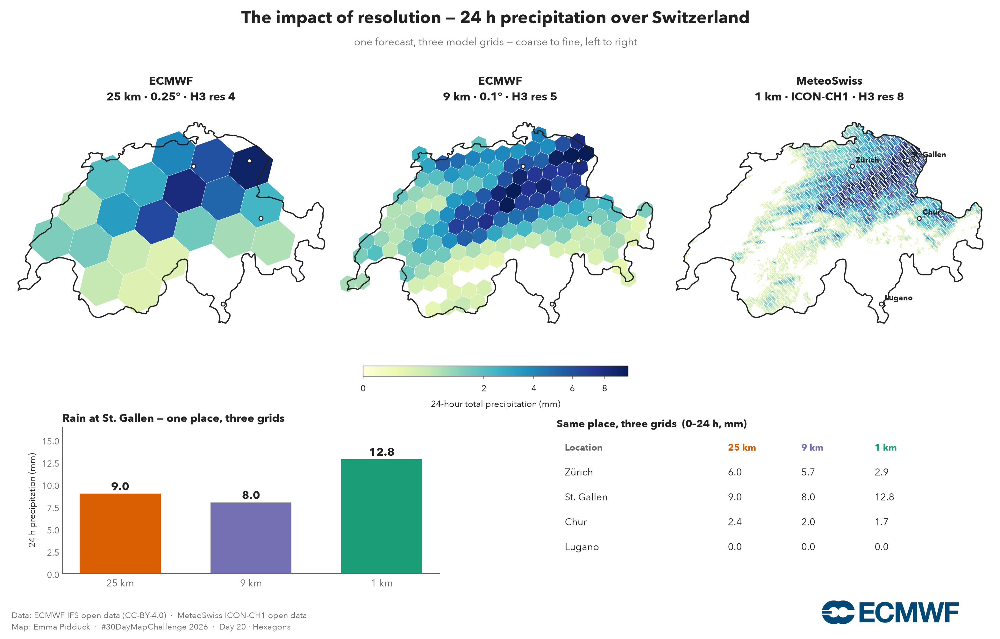

# Weather Maps · #30DayMapChallenge 2026

Beautiful, reproducible weather maps built on **open data** — from ECMWF's global forecasts
(9 km and 25 km) to MeteoSwiss's 1 km Alpine model — using ECMWF's own open-source Python tools.

Every map is a **self-contained Jupyter notebook**: method, code, output, data licence and
tools in one place. Nothing to install beyond `pip`; nothing hidden.

Most days run on **fully open data** — anyone can reproduce them. A few of Matthias's days
pull the **DestinE Climate DT** through Polytope, which needs *approved (upgraded) DestinE data
access*, not just a basic platform account; those days are marked **⬦ upgraded access** below.

> ⚠️ **Just for fun — not an official ECMWF product.** Claude (Anthropic) helped build these
> notebooks. They are **not** official ECMWF notebooks and are **not** supported by ECMWF — a
> personal #30DayMapChallenge experiment to show how approachable open weather data has become.

## The maps

- **[Day 2 · Lines](day02_lines_jet)** — the jet stream as 250 hPa wind, drawn as flowing streamlines.
- **[Day 3 · Polygons](day03_polygons)** — a Bulgarian November: rainfall by municipality, and a
  bivariate rain × temperature choropleth, from ERA5-Land.
- **[Day 3 · Polygons — Summer weather in Greece](day03_polygons_polytope)** — *Matthias
  Aengenheyster*. The polygon never downloads a grid: Greece goes into the request as 40 rings
  and 923 vertices, and **Polytope** returns just the 3,211 **DestinE Climate DT** cells inside
  it. Daytime maxima track altitude and ignore the sea; tropical nights track the coast — the
  half that matters for heat-health. **⬦ upgraded access.**
- **[Day 5 · Senses: Sight](day05_sight_ssd)** — how the *model* sees: the IFS rendered as a
  Meteosat-10 infrared image. What looks like a satellite photo is a six-day forecast — a **model
  product** (SEVIRI's spectral characteristics, but not the viewing geometry), a forecast tool, not a
  real observation. *(Operational ECMWF product; the sample here is shared one-off under CC-BY-4.0.)*
- **[Day 6 · Vintage](day06_vintage)** — **the Great Storm of 1987** as a mid-century surface
  analysis: ERA5 for 16 October 1987, 00 UTC — the ~953 hPa low over the Channel, isobars, wind
  barbs in knots, fronts from the 850 hPa θₑ gradient (an objective estimate, for fun) and the
  depression's overnight track, in sepia on aged paper. Drawn in the same hand as Matthias's 1953
  plate below. Modern reanalysis (back to 1940), old clothes.
- **[Day 6 · Vintage — The Night of the Great Flood](day06_vintage_1953)** — *Matthias
  Aengenheyster*. 31 January 1953, 18 UTC, drawn from the **ERA5 back extension** as a period
  surface chart. Fronts traced along the 850 hPa theta-e ridge; both bands classify as cold —
  the storm had occluded and the warm sector was gone.
- **[Day 8 · Utopia — When is your utopia?](day08_utopia_bestmonth)** — *Valters Žeižis*. Every place's
  most pleasant month (warm but not hot, dry, sunny and calm) from 30 years of **ERA5**. North of
  the equator, Africa's utopia comes with the dry season around January; south of it, around July;
  parts of East Africa get two. A Europe version adds world capitals and the best month to visit
  each ECMWF site.
- **[Day 9 · Urban-rural](day09_urban_rural)** — *Hungary, the sunshine country*, built on Hungary's
  own open data: mean annual sunshine (CARPATCLIM) and rainfall (HungaroMet/OMSZ), the sunny dry
  south-eastern plain against the cloudier, wetter hills and west — plus a year-of-sunshine GIF.
- **[Day 12 · Power](day12_power_wind)** — 100 m wind power density over the North Sea offshore-wind
  belt: the energy in the wind (½·ρ·V³), with the big farms marked.
- **[Day 14 · Borgesian map](day14_borgesian)** — *Matthias Aengenheyster*. After Borges' map at
  the scale of the empire: one **nextGEMS IFS** (~2.8 km) precipitation field, six concentric
  frames closing from 2,400 km onto a single 3.2 km HEALPix cell. Each blue box is the next
  panel's frame.
- **[Day 20 · Hexagons](day20_hexagons)** — one forecast on three model grids (25 → 9 → 1 km),
  binned into hexagons, so you can *see* what resolution buys you.
- **[Day 20 · Hexagons — the grid, and nothing but the grid](day20_healpix_nesting)** — *Matthias
  Aengenheyster*. The same storm with model identity held fixed: exact **HEALPix** nesting walks
  one nextGEMS field down zoom 11 → 7 (the peak falling 164 → 1.5 mm/h while the regional mean
  holds), the same ladder on the DestinE Climate DT, and a true H3 re-bin — which, unlike
  HEALPix, does not nest exactly. nextGEMS is public; the Climate DT panel is **⬦ upgraded
  access.**
- **[Day 22 · Projections](day22_projections)** — one 500 hPa height field on four projections,
  so the distortion every flat map makes becomes visible in the graticule.
- **[Day 23 · Senses: Taste — Eiswein watch](day23_taste_eiswein)** — *Valters Žeižis*. Ice wine needs
  grapes frozen on the vine at −7 °C. Each grape is one of 51 IFS ensemble forecasts (0.1° open
  data), coloured by its coldest night in the next 15 days, for 20 German and Austrian wine regions.
- **[Day 26 · Water](day26_water_vapour)** — total-column water vapour as an orthographic globe:
  the atmospheric rivers that carry more water than the Amazon, drawn on the sphere.
- **[Day 27 · New tool](day27_new_tool_zarr)** — **Storm Ciarán** (2 November 2023), pulled live
  from the ERA5 reanalysis as cloud-native **Zarr** (full hourly ARCO-ERA5): one hour out of a
  petabyte, no download — the same one line that reaches the 1987 storm on Day 6.
- **[Day 28 · Feeling](day28_feeling_utci)** — the day the UK hit 40 °C, as the Universal Thermal
  Climate Index (UTCI): what the heat actually *felt* like, from ERA5-HEAT reanalysis.

Use the sidebar to open each day. **Code is collapsed by default** — click the **＋** on any
cell to reveal it.

## How it's made

| Tool | Role |
|---|---|
| [`ecmwf-opendata`](https://github.com/ecmwf/ecmwf-opendata) | ECMWF IFS open data (0.25° & 0.1°) |
| **MARS** · [`ecmwf-api-client`](https://github.com/ecmwf/ecmwf-api-client) | IFS simulated satellite imagery (`ssd`, licensed — Day 5) |
| [`polytope-client`](https://github.com/ecmwf/polytope-client) · [`earthkit-geo`](https://earthkit-geo.readthedocs.io) | DestinE Climate DT feature extraction — the polygon *is* the query (Days 3, 20) |
| [`intake`](https://intake.readthedocs.io) | the public [Digital Earths Global Hackathon](https://digital-earths-global-hackathon.github.io/catalog/) catalogue — nextGEMS IFS (Days 14, 20) |
| [`healpy`](https://healpy.readthedocs.io) | HEALPix cell indexing, nesting and disc queries (Days 3, 14, 20) |
| [odp.met.hu](https://odp.met.hu) (HungaroMet / CARPATCLIM) | Hungary's open gridded climate — sunshine & rainfall (Day 9) |
| [`meteodata-lab`](https://github.com/MeteoSwiss/meteodata-lab) | MeteoSwiss ICON-CH1 1 km |
| [`earthkit-data`](https://earthkit-data.readthedocs.io) | reading GRIB |
| [`cdsapi`](https://github.com/ecmwf/cdsapi) | ERA5 / ERA5-HEAT from the Copernicus **Climate Data Store** (Days 6, 28) |
| [`zarr`](https://zarr.readthedocs.io) · [`gcsfs`](https://gcsfs.readthedocs.io) | cloud-native ERA5 (ARCO-ERA5), no download |
| [`h3`](https://h3geo.org) · `cartopy` · `matplotlib` | hexagons, projection, render |

## Data & licence

- **ECMWF Open Data** — Creative Commons **CC-BY-4.0**. © ECMWF · source www.ecmwf.int ·
  [Terms of Use](https://apps.ecmwf.int/datasets/licences/general/).
- **MeteoSwiss Open Data** — ICON-CH1-EPS via the Swiss open-data STAC API; attribute MeteoSwiss.
- **DestinE Climate DT** (Days 3, 20) — Climate DT phase 2, served through **Polytope**. Reaching
  it needs **approved (upgraded) DestinE data access**, not just a basic
  [DestinE account](https://platform.destine.eu/) — so these days are not reproducible on any
  laptop the way the open-data days are. `© ECMWF / Destination Earth` · Destination Earth is
  funded by the European Union and implemented by ECMWF, ESA and EUMETSAT.
- **nextGEMS IFS** (Days 14, 20) — cycle-3 `tco3999` run, distributed through the **Digital Earths
  Global Hackathon** catalogue (**public, no account required**). `© ECMWF` · nextGEMS was funded
  by the European Union (Horizon 2020, grant 101003470). Coastlines/borders are **Natural Earth**
  (public domain).
- **ERA5 monthly means** (Day 8) — ECMWF ERA5 reanalysis for C3S, via the CDS. Contains modified
  Copernicus Climate Change Service information.
- **ERA5-HEAT (UTCI)** — Copernicus Climate Change Service (C3S), via the CDS. Contains modified
  Copernicus Climate Change Service information.
- **ERA5** (Days 6, 27) — ECMWF ERA5 reanalysis for C3S. Day 6 is pulled from the **CDS** via
  `cdsapi`; Day 27 is served as cloud-native Zarr by Google (ARCO-ERA5,
  `gs://gcp-public-data-arco-era5`). Both contain modified Copernicus Climate Change Service information.
- **ECMWF simulated satellite imagery** (Day 5, `type=ssd`) — an ECMWF **operational** product,
  normally accessed under ECMWF's **service / charge model** (not the open-data release). The small
  sample used here (3 brightness-temperature fields) is shared **one-off** under
  **[CC-BY-4.0](https://creativecommons.org/licenses/by/4.0/)** so the notebook is reproducible.
  © ECMWF · source www.ecmwf.int.

- **CARPATCLIM & HungaroMet / OMSZ** (Day 9) — Hungary's sunshine from **CARPATCLIM**
  (*© European Commission – JRC, 2013*, via HungaroMet/OMSZ) and rainfall from **HungaroMet
  (OMSZ)**'s open gridded database ([odp.met.hu](https://odp.met.hu), free use with attribution).
  Processed at run time; only the maps are shared.

Maps by **[Emma Pidduck](https://www.linkedin.com/in/emmapidduck/)** (Days 2, 3, 5, 6, 9, 12, 20,
22, 26, 27, 28), **[Matthias Aengenheyster](https://www.linkedin.com/in/matthias-aengenheyster-2a0ba5199/)**
(Days 3, 6, 14, 20) and **[Valters Žeižis](https://www.linkedin.com/in/valterszeizis/)** (Days 8, 23).
